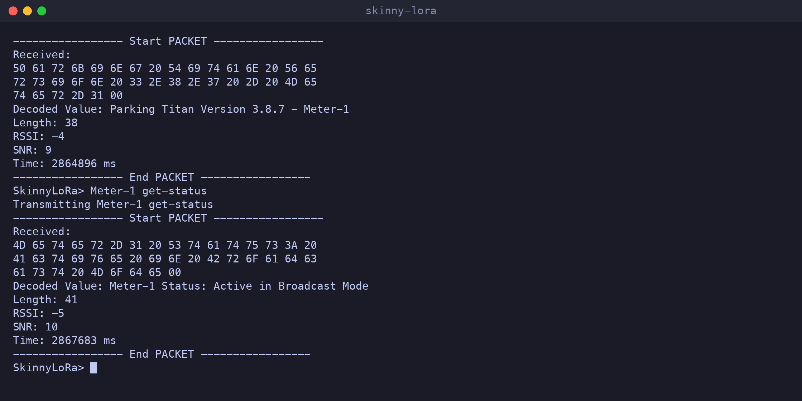
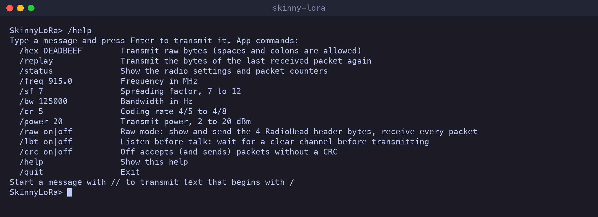
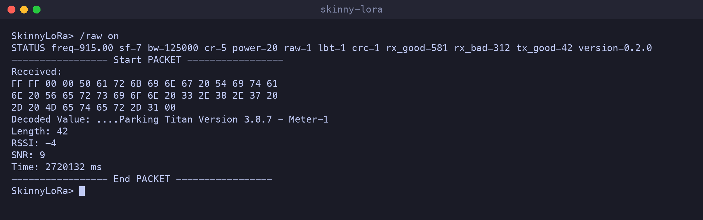

# Skinny-LoRa

Skinny-LoRa is a terminal application for transmitting and receiving LoRa traffic using a single Adafruit Feather M0 (or 32u4) with RFM95 LoRa Radio.


*Skinny-LoRa querying a simulated "Parking Titan" LoRa parking meter, then changing its remaining time.*

# Requirements

* An [Adafruit Feather M0 with RFM95 LoRa Radio](https://www.adafruit.com/product/3178) (or the Feather 32u4 version) with an antenna, for the band your module is made for (433, 868 or 915 MHz)
* Python 3.9 or newer
* [arduino-cli](https://arduino.github.io/arduino-cli/) or the Arduino IDE to flash the firmware

# Setup

### 1. Flash the Feather

The firmware is in [firmware/skinny-lora](firmware/skinny-lora). It needs the Adafruit board support and the [RadioHead](https://www.airspayce.com/mikem/arduino/RadioHead/) library, version 1.143.1 from the Arduino Library Manager.

**With arduino-cli** (find the port with `arduino-cli board list`):

```
$ make deps
$ make upload PORT=/dev/ttyACM0
```

For a Feather 32u4 add `FQBN=adafruit:avr:feather32u4` to both `make compile` and `make upload`.

**With the Arduino IDE:**

* Set up the Adafruit boards: https://learn.adafruit.com/adafruit-feather-m0-radio-with-lora-radio-module/setup
* Tools -> Manage Libraries -> search for RadioHead -> install version 1.143.1
* Open firmware/skinny-lora/skinny-lora.ino
* Select Tools -> Board -> Adafruit SAMD Boards -> Adafruit Feather M0 (SAMD21)
* Select Tools -> Port -> [Your Adafruit Feather M0]
* Click the Upload Button

The power on defaults (915 MHz, SF7, 125 kHz, 4/5, 20 dBm) are in the Configuration section at the top of the sketch. They can all be changed at runtime, see below.

### 2. Install the terminal application

```
$ pip install .
```

This installs the `skinny-lora` command. Running `python3 skinny-lora.py` from a checkout after `pip install -r requirements.txt` works too.

# Running the Application

```
$ skinny-lora -h

usage: skinny-lora [-h] [-p PORT] [--freq FREQ] [--sf SF] [--bw BW] [--cr CR] [--power POWER] [--raw] [--no-lbt] [--no-crc]
                   [--log FILE] [--history FILE] [--version]

Transmits and Receives LoRa Traffic. Defaults to Receive Mode

options:
  -h, --help       show this help message and exit
  -p, --port PORT  The serial port to attach to (default: the only Adafruit board plugged in)
  --freq FREQ      Frequency in MHz, e.g. 915.0
  --sf SF          Spreading factor, 7 to 12
  --bw BW          Bandwidth in Hz, e.g. 125000
  --cr CR          Coding rate denominator, 5 to 8
  --power POWER    Transmit power, 2 to 20 dBm
  --raw            Raw mode: receive every packet including the 4 RadioHead header bytes
  --no-lbt         Transmit without waiting for a clear channel
  --no-crc         Accept and send packets without a CRC
  --log FILE       Append received packets to FILE (.csv, or .jsonl for JSON Lines)
  --history FILE   Command history file (default: ~/.skinny_lora_history), pass '' to disable
  --version        show program's version number and exit
```

With a single Feather plugged in no options are needed. When two or more are plugged in, pick one with `-p`. On connecting, the app prints the radio settings as a `STATUS` line.

By default the application runs in receive mode and streams packets in the background until you enter data to transmit. Once the application transmits the packet, it immediately returns to streaming LoRa packets. Here a broadcast from a lab parking meter arrives, then `Meter-1 get-status` is sent and the meter answers:



Each packet shows:

* **Received:** the bytes, as hex
* **Decoded Value:** the bytes as text, with `.` for bytes that aren't printable
* **Length:** the number of bytes
* **RSSI** and **SNR:** signal strength in dBm and signal-to-noise ratio in dB
* **Time:** how long the Feather has been running, in ms

Messages can be up to 250 bytes long. Longer messages are rejected by the device and nothing is transmitted. Text messages are sent with a terminating `00` byte so receivers can treat them as C strings.

## Commands

Anything you type is transmitted, except lines starting with `/`. Type `/help` for the list:



| Command | |
|---|---|
| `/hex DEADBEEF` | Transmit raw bytes. Spaces and colons are allowed (`/hex de:ad be ef`) |
| `/replay` | Transmit the bytes of the last received packet again |
| `/status` | Show the radio settings and packet counters |
| `/freq 868.1` | Frequency in MHz |
| `/sf 9` | Spreading factor, 7 to 12 |
| `/bw 250000` | Bandwidth in Hz: 7800, 10400, 15600, 20800, 31250, 41700, 62500, 125000, 250000 or 500000 |
| `/cr 5` | Coding rate 4/5 to 4/8 |
| `/power 10` | Transmit power, 2 to 20 dBm |
| `/raw on` | Raw mode, see below |
| `/lbt off` | Listen before talk. On by default: wait up to 1 second for a clear channel, then give up |
| `/crc off` | Accept packets without a CRC, and send packets without one |
| `/help`, `/quit` | |

Start a message with `//` to transmit text that begins with `/`. Commands are saved in `~/.skinny_lora_history`, use the up arrow to recall them.

Both radios must use the same frequency, spreading factor, bandwidth and coding rate to hear each other.

## Raw mode

The RadioHead library puts a 4 byte header (to, from, id, flags) in front of every packet, and normally hides it and drops packets that are not addressed to everyone. In raw mode skinny-lora receives every packet and shows those 4 bytes as the start of the data, and `/hex`, `/replay` and typed text are transmitted exactly as given, with the first 4 bytes going out as the header. This makes it possible to capture and replay devices that do not use RadioHead.

The same meter broadcast as above, received in raw mode. The header bytes `FF FF 00 00` (to: everyone, from: 0xFF, id 0, flags 0) now come first:



Limitations: packets shorter than 4 bytes are dropped by the radio library, the sync word is fixed at RadioHead's 0x12, and SF6 is not supported.

## Logging

`--log packets.csv` appends every received packet to a CSV file, `--log packets.jsonl` writes JSON Lines instead. Each row has the computer's time, the device's uptime in ms, the length, RSSI, SNR, the bytes as hex and the decoded text.

## Bad packets

Packets that arrive with a CRC error, or without a CRC when one is required, never reach the application. The firmware counts them and reports them at most every 5 seconds:

```
Bad packets: 3 new, 14 total (CRC error or no CRC, send CRC:0 to accept packets without one)
```

## Serial protocol

The firmware can also be driven from any serial terminal at 115200 baud. Send one command per line:

| Command | |
|---|---|
| `TX:<text>` | Transmit text |
| `HEX:<hex>` | Transmit bytes |
| `FREQ:<MHz>`, `SF:<7-12>`, `BW:<Hz>`, `CR:<5-8>`, `PWR:<2-20>` | Radio settings |
| `RAW:<0/1>`, `LBT:<0/1>`, `CRC:<0/1>` | Modes |
| `STATUS` | Print the settings and counters |

Settings print a `STATUS` line when they are applied, invalid commands print a line starting with `ERR`. Settings are not saved and return to the defaults when the board restarts.

When no computer is connected the firmware starts after 3 seconds, so it also runs from a battery.

# Development

```
$ make install
$ make test
$ make compile
```

CI compiles the firmware for the Feather M0 and 32u4 and runs the tests on every push and pull request.
